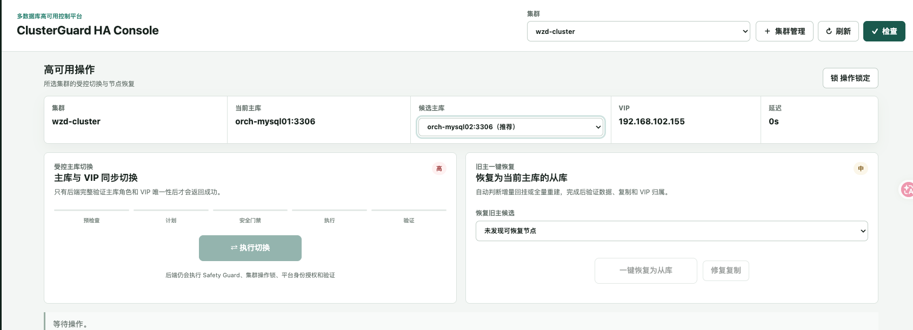
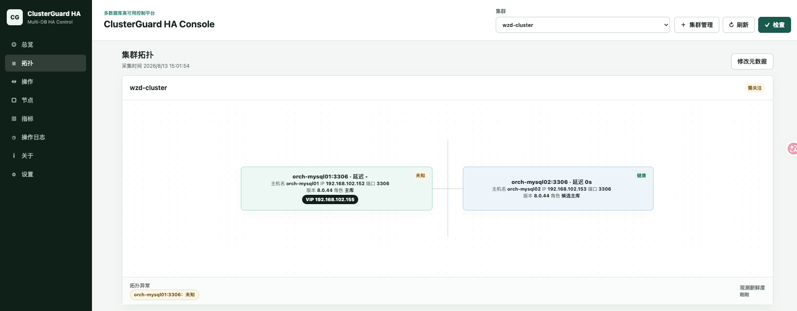

# ClusterGuard HA

### Enterprise Database High Availability and Failover Management Platform

**Make database failover safer. Make business recovery more controllable.**

<!-- LANGUAGE-SWITCH -->
> **Language:** English | [简体中文](README.md)
<!-- /LANGUAGE-SWITCH -->

ClusterGuard HA is a database high-availability management platform for **MySQL and PostgreSQL**. It provides one integrated HA management capability covering database cluster monitoring, primary/standby topology management, failure detection, safety arbitration, automatic or controlled failover, write-endpoint migration, failed-node recovery and operation audit.

Its core goal is not simply to promote a standby to primary. It is to ensure that when a database fails or during planned maintenance, and **on the premise that the safety conditions are met**, the **database write service moves safely from the old primary to a new primary, while no two nodes can hold legitimate write permission at the same time.**

## Why ClusterGuard HA?

Enterprise core business systems normally depend on the database providing service continuously.

Even with database primary/standby replication already deployed, several problems remain that replication alone cannot solve:

- After the primary database fails, who decides whether a switchover is needed?
- Among several standbys, which one should take over the business?
- How do you ensure the old primary will not come back online and cause split brain?
- After a primary/standby switchover, how does the business access endpoint migrate with it?
- After the primary recovers, how does it rejoin the cluster?
- How do you confirm the switchover really succeeded and trace the whole failure-handling process?

**Database replication solves data synchronization; ClusterGuard HA solves safe takeover and high-availability management after a database failure.**

## What Can ClusterGuard HA Do?

**Unified database cluster management**

Continuously discovers and monitors node state, primary/standby topology, replication relationships, replication lag and cluster health for MySQL and PostgreSQL.

**Safe primary/standby switchover**

Uses Raft-majority arbitration, replication safety checks, candidate assessment and operation gates to perform a planned switchover — or, once enabled, automatic failover — after the conditions are met.

**Automatic database write-endpoint migration**

Brings the database role change and the business write-endpoint migration into the same controlled flow, supporting a Linux VIP, a Docker Swarm host VIP, and the implemented Kubernetes write-endpoint mechanism.

**Reduced split-brain and wrong-takeover risk**

Node fencing, writer leases, endpoint leases and safety checks prevent the old primary and the new primary from both becoming legitimate writers. When switchover safety cannot be proven, the platform refuses the high-risk operation.

**Recovery management after a failure**

Provides former-primary rejoin, node rebuild, replication repair, operation verification and result reporting, reducing manual risk.

**Unified operation and audit**

Manages high-availability operations through a web console, CLI and HTTP API, and records execution stages, verification evidence and audit information for every critical change.

## The Core Idea Behind ClusterGuard HA

**A failure can happen, but a wrong takeover should not become a second incident.**

ClusterGuard HA moves database high availability away from scattered scripts and manual operations into one system with cluster arbitration, safety gates, controlled execution and result verification.

It is not a database proxy and not database backup software. Application traffic connects to the database write endpoint directly; ClusterGuard HA manages the ownership of the write endpoint and the database role transition.

## Where It Fits

Suited to enterprise core business databases, primary/standby clusters that need automatic or controlled failover, planned maintenance in production, database primary/standby migration, and operations that require explicit operation permission and failure audit.

MySQL and PostgreSQL are currently the main supported engines; Oracle Data Guard and SQL Server Always On are later controlled expansion directions.

**ClusterGuard HA — every database failover with evidence, control and verification.**

## Console Preview

The operations workbench keeps cluster context, primary and candidate selection, VIP state, controlled execution, recovery, topology, and audit evidence in one operator workflow.



The topology page is organized by immutable resource identity and answers four operational questions: which instance is the currently observed primary, which instances replicate and in which direction, which node owns the VIP, and which nodes are unreachable, degraded or require attention.



See the bilingual [product tour](docs/en-US/product-tour.md) for the node lifecycle and operation-log views.

## How It Differs from Other HA Tools

The same kind of tool as MHA or Orchestrator for MySQL, and Patroni or repmgr for PostgreSQL: something you keep running so that one primary stays writable and the write endpoint moves with it.

| | MHA / Orchestrator / Patroni / repmgr | ClusterGuard HA |
| --- | --- | --- |
| Engine coverage | One database per tool | MySQL and PostgreSQL under one control plane |
| Decision basis | Script or process state; a zero exit code is treated as "switched" | Every action is gated on *current* evidence: current topology, health and replication relationships |
| Proof of outcome | Logs for a human to read | Each step leaves verifiable evidence, an audit trail and a report; a change that did not verify is never presented as a success |
| Identity | hostname:port, hostname, or a name that changes | Immutable platform UUID plus native engine identity (`server_uuid`, `system_identifier`); hostname, IP and port are correctable coordinates |

## How It Works: Architecture and Safety

Three Raft controllers form the control plane: metadata is replicated across them and every authority decision — writer lease, endpoint lease, operation lock — needs a current majority. Database nodes may be separate from, or co-located with, controllers; node lifecycle tasks enforce an odd controller count and verify Raft membership.

```text
operators / automation
        |
        v
[ ClusterGuard HA control plane ]
  console | HTTP API | cgctl
  3 Raft controllers; every authority
  decision needs a current majority
        |
        | mTLS / HTTPS, allowlisted actions only
        v
[ restricted node agent, one per host ]
        |
        v
[ database nodes: primary + replicas ]
[ write endpoint: Linux VIP, Kubernetes Service, Swarm host VIP ]

clients ------> write endpoint (direct; traffic never enters the control plane)
```

Client traffic goes to the write endpoint directly; it never passes through ClusterGuard. The control plane moves the endpoint's owner and then verifies that the move happened.

Every implemented mutation passes the same workflow, and a mutation that did not verify is never presented as a success:

```text
DISCOVER -> PRECHECK -> PLAN -> SAFETY_GUARD -> LOCK -> APPROVE -> EXECUTE -> VERIFY -> AUDIT -> REPORT
```

The safety mechanisms behind that workflow:

- **Evidence before action.** A real role or write-endpoint change becomes executable only when the cluster has a complete HA endpoint inventory, an odd Raft controller set, current Leader-backed majority authority, purpose-specific database credentials, agent signing material, an operation lock and an approval. Missing or unknown evidence blocks the operation.
- **Unavailability before a second writer.** The platform prefers a period of unavailability over a second writer or a second endpoint owner. Stale authorization expires, the old node fails closed to no endpoint plus persistent read-only, and the Leader revalidates the exact transition lease before promotion.
- **The data path stays direct.** Applications connect to the write endpoint themselves; ClusterGuard does not proxy, buffer or route database traffic, and it never edits database data files.
- **Automatic failover is opt-in.** When enabled it requires four current failure observations spanning at least three seconds, the rank-one eligible candidate, current controller quorum, old-primary isolation and an exclusive endpoint lease. An external BMC, PDU, cloud or hypervisor fencer remains an optional stronger layer. The three-second figure is the controller's stable-failure evidence window, not an end-to-end RTO promise; the restricted Agent keeps a separate 15-second authorization-expiry fence before an isolated old primary can no longer serve as writer or endpoint owner.
- **High availability is not a zero-downtime, zero-data-loss promise.** The design deliberately chooses safety first: when old-primary isolation or candidate safety cannot be proven, the platform refuses to switch. That refusal is a safety feature of the product, not a guarantee that any failure will recover unconditionally.
- **Databases, data and backups stay yours.** The platform does not take over database software, data directories, replication topology or backup policy, and the upgrade plane does not touch them either.
- **Identity is immutable; coordinates are not.** Renaming a host, changing an IP or moving a port updates an endpoint and keeps the same platform instance.
- **The database is not bundled.** The complete installation kit does not embed MySQL or PostgreSQL binaries; supply the approved database media on site.

## Supported Engines and Versions

| Engine | Status | Scope |
| --- | --- | --- |
| MySQL | Supported | The sealed 2.1 line is the MySQL HA product line, and MySQL HA is retained in 2.2 and later. Discovery covers MySQL 5.7, 8.0, 8.4 and 9.x; tested MySQL 5.7/8.x/9.x mutation dialects run behind an independent adapter and writer-endpoint contract. The 9.x dialect path is unit-tested against 9.7.0 only and has no recorded 9.x site qualification. Kubernetes write-endpoint takeover is currently MySQL-only. |
| PostgreSQL | Delivered from 2.2 | PostgreSQL 16.4: inventory-scoped discovery, `system_identifier` cluster binding, primary/standby topology, streaming health, timeline and WAL evidence, deterministic candidate assessment, guarded switchover and failover, `pg_rewind` former-primary recovery, allowlisted low-risk repair, and `pg_basebackup`/`pg_rewind` node lifecycle. |
| Oracle | Gated future line | Data Guard Broker discovery, health, topology, standby candidate assessment, precheck, plan, execute and dual-node verification for controlled switchover. A dedicated password-file `SYSDG` account is used instead of `SYS`; the local Agent runs DGMGRL as the Oracle operating-system account and accepts only configured Broker members. Failover stays blocked until old-primary fencing is configured. Code may exist behind capability gates, but it is not a production claim. |
| SQL Server | Gated future line | Always On read-only discovery, health, topology, synchronized-secondary candidate assessment, precheck, plan, execute, verify and send/redo queue metrics for planned failover to a synchronized synchronous-commit secondary. Discovery and execution are advertised only when `sqlcmd` is available or a SQL Server runner is injected, and forced failover stays blocked by default unless an explicit data-loss approval policy is configured. |

Runtime targets: bare metal or virtual machines (systemd-managed database), Docker Swarm (fixed single-replica Service) and Kubernetes (dedicated single-replica StatefulSet). Mutations are advertised only when the restricted Agent, operation credentials, endpoint provider, controller quorum and required fencing evidence are configured; these capabilities are not retroactively added to `v2.1.45`.

### Current Installation Kit: 3.1.3.1 (Local Candidate)

The complete Linux x86_64 installation kit is local at `release/3.1.3.1/`: product **3.1.3.1**, RPM compatibility baseline **2.2-109**. Supply approved database media on site. See [release notes](docs/en-US/release-3.1.3.1.md) and the [complete installer option reference](docs/en-US/offline-installer-parameters.md). Source and documentation are committed to GitHub; no GitHub Release is published for this candidate. ART/FIELD remain OPEN.

### Recorded Formal Releases

Release policy and support boundary:

- `v2.1.45` is the immutable final release of the 2.1 line.
- The supported 2.1 database engine is MySQL, including approved compatible
  MySQL distributions validated by the site acceptance matrix.
- `v2.2.39` is the first formal 2.2 release, delivering PostgreSQL 16.4,
  Docker Swarm adoption, and the Kubernetes writer-endpoint foundation.
- Any shipped feature or behavior change increments the package release; an
  existing RPM, offline archive, tag, or GitHub Release is never overwritten.
- **GitHub Releases carry complete offline installation media only.** Signed
  `.cgupgrade` update packages (including legacy `.cgpatch`) are delivered to
  contracted enterprise customers only and are **never** uploaded to GitHub or
  any other public channel; a public copy is treated as unauthorized
  distribution and is removed on sight. See
  [release policy §3.1](docs/en-US/version-release-policy.md).
- Oracle and SQL Server code may exist behind capability gates, but it is not a
  production claim for the sealed 2.1 line.

| Line | Status | Production support boundary |
| --- | --- | --- |
| `2.1.45` | Stable and sealed | MySQL HA control plane |
| `2.2.39` | Formal release | PostgreSQL 16.4, Docker Swarm, and retained MySQL HA capabilities |
| Later lines | Roadmap | Oracle Data Guard Broker and SQL Server Always On after separate qualification |

Download the recorded formal `2.2.39` release from
[ClusterGuard HA 2.2.39](https://github.com/dgudgh/ClusterGuard-HA/releases/tag/v2.2.39):

```bash
curl -fLO https://github.com/dgudgh/ClusterGuard-HA/releases/download/v2.2.39/clusterguard-ha-2.2-39-offline-linux-x86_64.tar.gz
curl -fLO https://github.com/dgudgh/ClusterGuard-HA/releases/download/v2.2.39/clusterguard-ha-2.2-39-offline-linux-x86_64.tar.gz.sha256
sha256sum -c clusterguard-ha-2.2-39-offline-linux-x86_64.tar.gz.sha256
```

The sealed 2.1 MySQL release remains available from
[ClusterGuard HA 2.1-45](https://github.com/dgudgh/ClusterGuard-HA/releases/tag/v2.1.45):

```bash
curl -fLO https://github.com/dgudgh/ClusterGuard-HA/releases/download/v2.1.45/clusterguard-ha-2.1-45-offline-linux-x86_64.tar.gz
curl -fLO https://github.com/dgudgh/ClusterGuard-HA/releases/download/v2.1.45/clusterguard-ha-2.1-45-offline-linux-x86_64.tar.gz.sha256
sha256sum -c clusterguard-ha-2.1-45-offline-linux-x86_64.tar.gz.sha256
```

Published SHA-256 values:

```text
d4a46bdfa4c95bb641a7d19f063d2f43219177658b01b914a31a1cd5d06ec590  clusterguard-ha-2.1-45-offline-linux-x86_64.tar.gz
1bc70109b556e973744bb05b5be0f53b075260910ae5def25518631ff8629a1c  clusterguard-ha-2.1-45.x86_64.rpm
```

> **Qualification status:** Automated tests and laboratory acceptance do not
> replace site qualification. Before production use, validate the exact MySQL
> package, operating system, storage, network, fencing policy, VIP provider and
> three-controller deployment. PostgreSQL acceptance belongs to the 2.2 line
> and is documented separately in
> [postgresql-ha.md](docs/postgresql-ha.md).

## Quick Start

ClusterGuard HA requires Go 1.22 or newer.

Create a dedicated MySQL account with only the permissions needed by the
documented read-only queries. Keep secrets in environment variables, never in
the JSON configuration.

```bash
export CG_CONTROL_TOKEN='replace-with-a-control-api-secret'
export CG_MYSQL_DISCOVERY_PASSWORD='replace-with-the-read-only-secret'
export CG_POSTGRESQL_DISCOVERY_PASSWORD='replace-with-the-pg-monitor-secret'
export CG_POSTGRESQL_OPERATION_PASSWORD='replace-with-the-pg-operation-secret'
export CG_POSTGRESQL_REPLICATION_PASSWORD='replace-with-the-pg-replication-secret'
export CG_ORACLE_DISCOVERY_PASSWORD='replace-with-the-dgbroker-monitor-secret'
export CG_ORACLE_OPERATION_PASSWORD='replace-with-the-dgbroker-operation-secret'
export CG_SQLSERVER_DISCOVERY_PASSWORD='replace-with-the-ag-monitor-secret'
export CG_SQLSERVER_OPERATION_PASSWORD='replace-with-the-ag-operation-secret'
# Optional, only on controllers that execute these engines:
# export PATH="/opt/oracle/product/bin:/opt/mssql-tools18/bin:$PATH"
go run ./cmd/clusterguard --config configs/clusterguard.example.json
```

When started directly from the source configuration, the console and API are
served from `http://127.0.0.1:8088/` by default. The supported RPM/offline
deployment serves HTTPS on port `3000`.

The browser console authenticates against platform users stored in the
replicated metadata snapshot. A fresh installation creates `admin` with
`MustChangePassword=true`. Unless the deployment sets
`bootstrap_admin_password_env`, the Leader generates the first-login password
and writes it to a root-only `bootstrap-admin-password` file (mode 0600) beside
the metadata file; read it on the control node where it appears. The platform
removes that file once the first password change succeeds. The first password
change is mandatory: until it succeeds, all cluster and metadata API reads and
every mutation are blocked. The password is stored only as an Argon2id hash; it
is never written to configuration, environment files, audit events, or reports.
Sessions have an eight-hour absolute lifetime, use HttpOnly SameSite cookies
plus CSRF validation, and are revoked by password change or logout.

This example configuration keeps the restricted node agent and automatic
failover disabled, so it is a read-only control plane until you configure them.

Service managers should use `/healthz` for liveness and `/readyz` for
fail-closed control-plane readiness. Authenticated operators can use
`cgctl status` or `/api/v1/control-plane/status` for Raft role, Leader, quorum,
metadata revision, active work, and uptime diagnostics. Every API response has
an `X-Request-ID` that is preserved when a follower forwards a mutation to the
current Leader.

The production binary is `clusterguard`; the CLI is `cgctl`. The distribution
uses `/etc/clusterguard/`, `/var/lib/clusterguard/`, and
`/var/log/clusterguard/`. The systemd unit is
`packaging/systemd/clusterguard-ha.service`.

`scripts/build-clusterguard-bundle.sh` produces the controller, CLI, restricted
agent, lifecycle helpers, systemd units, log rotation, configuration samples,
and a full SHA-256 manifest. `scripts/clusterguard-install.sh` is a per-node
lifecycle helper; it is not the initial multi-node production bootstrap tool.

Use `scripts/install_clusterguard.sh` and the complete offline kit for the
initial production deployment. It creates the control plane, fixed resource
identities, certificates, database topology, Agent configuration, and VIP
reconciliation policy as one audited workflow. See
[English offline installation](docs/en-US/offline-rpm-install.md) /
[中文离线安装](docs/zh-CN/offline-rpm-install.md).

### Register and Refresh a MySQL Cluster

Registration creates the authoritative endpoint inventory. Hostname, IP, and
port are coordinates, not resource identifiers.

```bash
curl -sS -X POST http://127.0.0.1:8088/api/v1/clusters \
  -H 'content-type: application/json' \
  -H "Authorization: Bearer ${CG_CONTROL_TOKEN}" \
  -d '{
    "display_name":"payments-mysql",
    "engine":"mysql",
    "endpoints":[
      {"hostname":"mysql-a","ip_address":"192.0.2.10","port":3306},
      {"hostname":"mysql-b","ip_address":"192.0.2.11","port":3306},
      {"hostname":"mysql-c","ip_address":"192.0.2.12","port":3306}
    ]
  }'
```

Use the returned platform cluster UUID to refresh the registered inventory.
The body is exactly an empty JSON object; credentials and endpoint overrides
are rejected because credentials are resolved on the server.

```bash
curl -sS -X POST \
  http://127.0.0.1:8088/api/v1/clusters/<cluster-uuid>/discover \
  -H 'content-type: application/json' \
  -H "Authorization: Bearer ${CG_CONTROL_TOKEN}" \
  -d '{}'
```

### Register and Refresh a PostgreSQL Cluster

Each PostgreSQL instance must have a unique immutable
`clusterguard.node_id`. Every standby also declares the current primary's node
UUID in `clusterguard.primary_node_id`. ClusterGuard binds the cluster to
`pg_control_system().system_identifier`; changing hostname, IP, or port updates
the endpoint and retains the same platform instance UUID.

Enable the `postgresql` configuration block, set the dedicated discovery,
operation, and replication credential environments, and register only
authoritative endpoints:

```bash
curl -sS -X POST http://127.0.0.1:8088/api/v1/clusters \
  -H 'content-type: application/json' \
  -H "Authorization: Bearer ${CG_CONTROL_TOKEN}" \
  -d '{
    "display_name":"payments-postgresql",
    "engine":"postgresql",
    "endpoints":[
      {"hostname":"pg-a","ip_address":"192.0.2.20","port":5432},
      {"hostname":"pg-b","ip_address":"192.0.2.21","port":5432}
    ]
  }'

curl -sS -X POST \
  http://127.0.0.1:8088/api/v1/clusters/<cluster-uuid>/discover \
  -H 'content-type: application/json' \
  -H "Authorization: Bearer ${CG_CONTROL_TOKEN}" \
  -d '{}'
```

The console exposes PostgreSQL topology, health, native metrics, candidate
evidence, guarded operations, node synchronization, audit, and reports. Every
mutating control remains disabled until the corresponding runtime capability
and safety evidence are real; the console never presents simulated success.
See [postgresql-ha.md](docs/postgresql-ha.md) for database grants, restricted
Agent policy, lifecycle, fencing, and production qualification.

### CLI

```bash
go run ./cmd/cgctl engines
go run ./cmd/cgctl clusters
go run ./cmd/cgctl topology <cluster-uuid>
go run ./cmd/cgctl health <cluster-uuid>
go run ./cmd/cgctl candidates <cluster-uuid>
go run ./cmd/cgctl metrics <cluster-uuid>
go run ./cmd/cgctl refresh <cluster-uuid>
go run ./cmd/cgctl operation <operation-uuid>
go run ./cmd/cgctl approval issue --cluster <cluster-uuid> --engine mysql \
  --kind switchover --target <instance-uuid> --issued-by <administrator> --ttl 5m
go run ./cmd/cgctl approval list
go run ./cmd/cgctl approval show <grant-uuid>
```

`cgctl` uses the control token from `CG_CONTROL_TOKEN` for authenticated reads
and writes. Use
`--token-env <name>` before the command to select a different environment
variable; the secret is never accepted as a command-line value. Approval
issuance also reads this administrator credential. The returned approval token
is printed once and is never persisted by `cgctl`.

If the administrator password is lost, there is no online bypass or reset API.
After backing up metadata and pausing mutations, create a private one-time
artifact with `clusterguard admin prepare-recovery`, distribute that same
artifact to all controllers as `clusterguard:clusterguard` mode `0600`, and
restart them one at a time. The Raft Leader applies its recovery ID once,
revokes existing sessions, forces a password change, audits the action, and
removes the artifact on every node. See [operations.md](docs/operations.md) for
the complete procedure. Never edit password hashes or create a shared default
password in a live Raft set.

The HA matrix supports browser-equivalent session execution:

```bash
export CG_PLATFORM_USERNAME='admin'
export CG_PLATFORM_PASSWORD='<current-platform-password>'
scripts/clusterguard-ha-matrix.sh \
  --api http://127.0.0.1:8088 \
  --clusters '<cluster-uuid>' \
  --platform-session
```

On a fresh metadata store, set `CG_PLATFORM_NEW_PASSWORD` as well. Omitting
`--platform-session` keeps the explicit one-time grant mode for service
automation tests.

Place global flags before the command:

```bash
go run ./cmd/cgctl --json topology <cluster-uuid>
go run ./cmd/cgctl --server http://127.0.0.1:8088 clusters
```

See [operations.md](docs/operations.md) for the complete API workflow and
operator procedures. See [architecture.md](docs/architecture.md) for resource
identity, adapter, persistence, candidate, and safety design.

## Documentation

The [bilingual documentation center](docs/README.md) maps every maintained
English document to its Simplified Chinese counterpart. Read applicable rules
before the task guide; use release and acceptance records for traceability:

- [Reading order and applicable rules](docs/development/rules/README.md) / [Development modules](docs/development/README.md)
- [Mandatory upgrade contract](docs/upgrade-validation-chain.md) / [Gate workflow](docs/zh-CN/validation-gate-workflow.md)
- [English documentation](docs/en-US/README.md) / [中文文档](docs/zh-CN/README.md)
- [English product tour](docs/en-US/product-tour.md) / [中文产品导览](docs/zh-CN/product-tour.md)
- [English offline installation](docs/en-US/offline-rpm-install.md) / [中文离线安装](docs/zh-CN/offline-rpm-install.md)
- [English operations manual](docs/en-US/operations-manual.md) / [中文运维手册](docs/zh-CN/operations-manual.md)
- [English version update guide](docs/en-US/update-and-patch.md) / [中文版本升级与回退手册](docs/zh-CN/update-and-patch.md)
- [English release policy](docs/en-US/version-release-policy.md) / [中文版本规范](docs/zh-CN/version-release-policy.md)

## License

ClusterGuard HA is licensed under the **GNU Affero General Public License, version 3 only**
(`AGPL-3.0-only`). The full text is [LICENSE](LICENSE).

In short: you may use, modify and sell it, but if you make a modified version available to
others — **including as a network service only** — you must publish the Corresponding Source
under the same license. Running it unmodified for your own operations creates no publication
duty. Contracted customers receive the software under these same terms; the channel rule that
keeps update packages off the public channel is a delivery policy, not a license restriction.

Third-party components and their licenses — the MPL-2.0 modules linked into the binaries and
the packages bundled in the offline kit — are listed in
[THIRD-PARTY-NOTICES.md](THIRD-PARTY-NOTICES.md). The obligations are spelled out scenario by
scenario in [Licensing and Compliance](docs/en-US/licensing.md) /
[许可与合规](docs/zh-CN/licensing.md).

Verify that `LICENSE`, `go.mod`, the RPM metadata and the packaging scripts stay in agreement
after any dependency or packaging change:

```bash
node tools/verify-license-consistency.cjs
```

## Maintainer Notes

### Document and gate workflow

Read the [repository rules](AGENTS.md), the [gate workflow](docs/zh-CN/validation-gate-workflow.md), and the [reading order and applicable rules](docs/development/rules/README.md) before making changes; then select the relevant [development module](docs/development/README.md). Before modifying or executing work within the upgrade contract's scope, read the complete [mandatory v2 contract](docs/upgrade-validation-chain.md). Installation and operations follow the matching version's task guide after its applicable rules. Any Markdown change must be registered in the [Markdown change record](docs/development/markdown-change-record.md) and must rebuild the generated documentation pages.

### Recorded v2 source repair and acceptance status

The recorded source repair baseline is `7b643f4` (2026-10-03), on the sole mainline `codex/2.2-postgresql`. That repair enforces the v2 contract for updates and hotfixes: failed hotfixes use `retry`; interrupted rolling updates use `resume`. Its new-artifact and site ART/FIELD acceptance record remains **OPEN**; that repair produced no new package or production deployment. See the [implementation and acceptance record](docs/en-US/upgrade-validation-chain-implementation-status.md). This record does not replace verification of the current checkout, package, or site.
